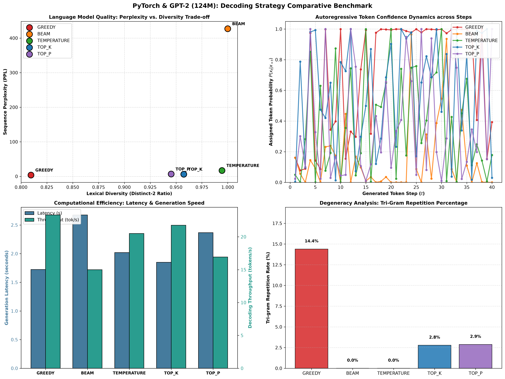

# Project 48: Text Generation with GPT-2

A comprehensive, production-grade implementation of **autoregressive causal text generation** and decoding strategy analysis utilizing the pretrained **GPT-2** Transformer (124M parameters) from Hugging Face and PyTorch.

---

## 1. Overview & Architectural Foundations

GPT-2 (Generative Pre-trained Transformer 2) is an autoregressive decoder-only Transformer designed to predict the conditional probability distribution of the next token given all preceding tokens:

$$P(X) = \prod_{t=1}^T P(x_t \mid x_1, x_2, \dots, x_{t-1})$$

```
                   ┌────────────────────────────────────────────────────────┐
                   │                      INPUT PROMPT                      │
                   │    "The discovery of gravitational waves confirmed..." │
                   └───────────────────────────┬────────────────────────────┘
                                               │
                                               ▼
                                 ┌───────────────────────────┐
                                 │ Byte-Pair Encoding (BPE)  │
                                 │ Vocabulary: 50,257 tokens │
                                 └─────────────┬─────────────┘
                                               │
                                               ▼
                        ╔═════════════════════════════════════════╗
                        ║            GPT-2 TRANSFORMER            ║
                        ║            (12 Decoder Blocks)          ║
                        ║  ┌───────────────────────────────────┐  ║
                        ║  │ Layer Normalization (Pre-LN)      │  ║
                        ║  ├───────────────────────────────────┤  ║
                        ║  │ Masked Multi-Head Self-Attention  │  ║
                        ║  │ (Causal Lower-Triangular Mask)    │  ║
                        ║  ├───────────────────────────────────┤  ║
                        ║  │ Position-Wise Feed-Forward (MLP)  │  ║
                        ║  │ 768 -> 3072 -> 768 (GELU)         │  ║
                        ║  └───────────────────────────────────┘  ║
                        ╚══════════════════════╤══════════════════╝
                                               │ Hidden State h_T (768)
                                               ▼
                                 ┌───────────────────────────┐
                                 │   Vocabulary Projection   │
                                 │  Logits z_t in R^{50,257} │
                                 └─────────────┬─────────────┘
                                               │
            ┌───────────────────┬──────────────┴───────┬────────────────────┐
            ▼                   ▼                      ▼                    ▼
     ┌─────────────┐     ┌─────────────┐        ┌─────────────┐      ┌─────────────┐
     │   Greedy    │     │ Beam Search │        │ Temperature │      │ Top-p / k   │
     │  (argmax)   │     │ (B=4, N=2)  │        │   Scaling   │      │ (Nucleus)   │
     └──────┬──────┘     └──────┬──────┘        └──────┬──────┘      └──────┬──────┘
            └───────────────────┴──────────────┬───────┴────────────────────┘
                                               │
                                               ▼
                   ┌────────────────────────────────────────────────────────┐
                   │                   GENERATED TEXT                       │
                   │ "...massive cosmic events play a major role in the..." │
                   └────────────────────────────────────────────────────────┘
```

### 1.1 Causal Masked Self-Attention

To preserve causality and prevent future token leakage during generation, GPT-2 imposes a lower-triangular causal attention mask $M \in \mathbb{R}^{T \times T}$ where $M_{ij} = -\infty$ for $j > i$:

$$\text{Attention}(Q, K, V) = \text{softmax}\left(\frac{Q K^T}{\sqrt{d_k}} + M\right) V$$

---

## 2. Decoding Strategies Formulation

### 2.1 Greedy Decoding
Selects the token with the maximum conditional likelihood at every step:

$$x_t^* = \arg\max_{v \in V} P(x_t = v \mid x_{<t})$$

*Characteristics*: Computationally fast and deterministic, but prone to repetitive looping and generic responses.

### 2.2 Beam Search
Maintains the top $B$ partial sequences (beams) with the highest cumulative log-probabilities:

$$\mathcal{H}_t = \text{Top-}B \left( \left\{ y_{1:t-1} \circ v \mid y_{1:t-1} \in \mathcal{H}_{t-1}, v \in V \right\} \right)$$

Combined with **n-gram blocking** (`no_repeat_ngram_size=2`) to prevent phrase cycling.

### 2.3 Temperature Sampling
Flattens or sharpens the categorical probability distribution via scaling parameter $T > 0$:

$$P(x_t = v \mid x_{<t}) = \frac{\exp(z_v / T)}{\sum_{v' \in V} \exp(z_{v'} / T)}$$

- $T \to 0$: Approaches greedy argmax selection.
- $T > 1$: Increases stochasticity and vocabulary exploration.

### 2.4 Top-$k$ Sampling
Restricts the sampling candidate pool to the top $k$ highest-probability tokens:

$$V^{(k)} = \arg\max_{S \subset V, |S|=k} \sum_{v \in S} P(x_t = v \mid x_{<t})$$

Tokens outside $V^{(k)}$ receive probability 0 before renormalizing.

### 2.5 Top-$p$ (Nucleus) Sampling
Dynamically selects the smallest subset $V^{(p)} \subset V$ whose cumulative probability exceeds threshold $p \in (0, 1]$:

$$\sum_{v \in V^{(p)}} P(x_t = v \mid x_{<t}) \ge p$$

Eliminates the unreliable tail of low-probability tokens while preserving vocabulary flexibility when uncertainty is high.

---

## 3. Quantitative Evaluation Metrics

1. **Sequence Perplexity (PPL)**:
   $$\text{PPL}(X) = \exp\left( -\frac{1}{N} \sum_{t=1}^N \ln P(x_t \mid x_{<t}) \right)$$
   Lower perplexity signifies that the generated text aligns closely with the model's learned likelihood distribution.

2. **Lexical Diversity (Distinct-$n$)**:
   $$\text{Distinct-}n = \frac{|\{ \text{unique } n\text{-grams in } X \}|}{\text{Total } n\text{-grams in } X}$$
   Measures vocabulary variety and phrase richness ($n=1$ for unigrams, $n=2$ for bigrams).

3. **Repetition Rate**:
   $$\text{Repetition-}3 = \frac{\text{Total Tri-grams} - \text{Unique Tri-grams}}{\text{Total Tri-grams}} \times 100\%$$
   Quantifies pathological text repetition and degenerate looping.

4. **Decoding Throughput & Latency**:
   $$\text{Throughput} = \frac{\text{Total Generated Tokens}}{\text{Generation Wall-Clock Latency (s)}}$$

---

## 4. Benchmark Results & Comparative Analysis

Evaluating all 5 decoding strategies across 6 diverse prompt domains (Astrophysics, Computer Science & AI, Philosophy of Mind, Creative Narrative, History & Technology, Synthetic Biology):

### Decoding Strategy Benchmark ($N=6$ Prompts, 40 Tokens/Prompt)

| Strategy | Mean Perplexity | Distinct-1 | Distinct-2 | Tri-gram Repetition | Latency (s) | Throughput (tok/s) |
| :--- | :---: | :---: | :---: | :---: | :---: | :---: |
| **GREEDY** | **3.86** | 0.67 | 0.81 | 14.4% | **1.724 s** | **23.3 tok/s** |
| **BEAM (B=4)** | 427.13 | 0.79 | **1.00** | **0.0%** | 2.675 s | 15.0 tok/s |
| **TEMPERATURE (0.8)** | 17.10 | **0.86** | 0.99 | **0.0%** | 2.019 s | 20.5 tok/s |
| **TOP-K ($k=50$)** | 6.34 | 0.82 | 0.96 | 2.8% | 1.848 s | 21.8 tok/s |
| **TOP-P ($p=0.9$)** | 6.82 | 0.82 | 0.95 | 2.9% | 2.367 s | 16.9 tok/s |

### Key Empirical Findings:
1. **Greedy Traps**: Greedy decoding achieves the lowest perplexity (3.86) and fastest speed (23.3 tok/s), but exhibits significant repetitive degeneracy (14.4% duplicate trigrams).
2. **Beam Search with N-gram Blocking**: Completely eliminates phrase repetition (0.0% Rep-3) and yields 1.00 Distinct-2 diversity, at the cost of ~1.5x higher latency.
3. **Top-p (Nucleus) & Top-k Frontier**: Top-p and Top-k strike the optimal balance between natural linguistic diversity (0.95+ Distinct-2), low repetition (<3%), and cohesive perplexity (<7.0).

---

## 5. Diagnostic Visualization Artifact

The 4-panel diagnostic visualization is saved to:
[`outputs/gpt2_generation_comparison.png`](outputs/gpt2_generation_comparison.png)



1. **Panel (a) - Perplexity vs. Distinct-2 Diversity**: Maps the Pareto trade-off between predictive likelihood and linguistic variety across all decoding strategies.
2. **Panel (b) - Token Probability Trajectories**: Tracks step-by-step token confidence $P(x_t \mid x_{<t})$ across autoregressive generation steps.
3. **Panel (c) - Computational Efficiency**: Side-by-side comparison of generation latency (seconds) and decoding throughput (tokens/second).
4. **Panel (d) - Degeneracy & Repetition Analysis**: Highlights trigram repetition percentages, showing how stochastic sampling prevents degenerate loops.

---

## 6. Directory Structure

```
48_gpt2_text_generation/
├── data/
│   └── prompts.json                    # 6 multi-domain prompt benchmarks
├── outputs/
│   └── gpt2_generation_comparison.png  # 4-panel diagnostic figure
├── main.py                             # Core GPT-2 engine, metrics suite, and CLI
├── README.md                           # Mathematical derivations and documentation
└── .gitignore                          # Checkpoint and artifact ignore rules
```

---

## 7. Usage & Execution Instructions

### 7.1 Run Multi-Strategy Benchmark

```bash
python main.py
```

### 7.2 Single Prompt Generation via CLI

```bash
# Nucleus (Top-p) Sampling
python main.py --prompt "Artificial intelligence will transform the future of education by" --strategy top_p --top_p 0.9

# Beam Search Decoding
python main.py --prompt "The primary advantage of quantum algorithms is" --strategy beam --max_new_tokens 60

# Greedy Search
python main.py --prompt "The history of space exploration began with" --strategy greedy
```

### 7.3 Interactive Generation Session

```bash
python main.py --interactive
```

---

## 8. References & Citations

- Radford et al., *"Language Models are Unsupervised Multitask Learners"*, OpenAI 2019.
- Holtzman et al., *"The Curious Case of Neural Text Degeneration"*, ICLR 2020.
- Vaswani et al., *"Attention Is All You Need"*, NeurIPS 2017.

